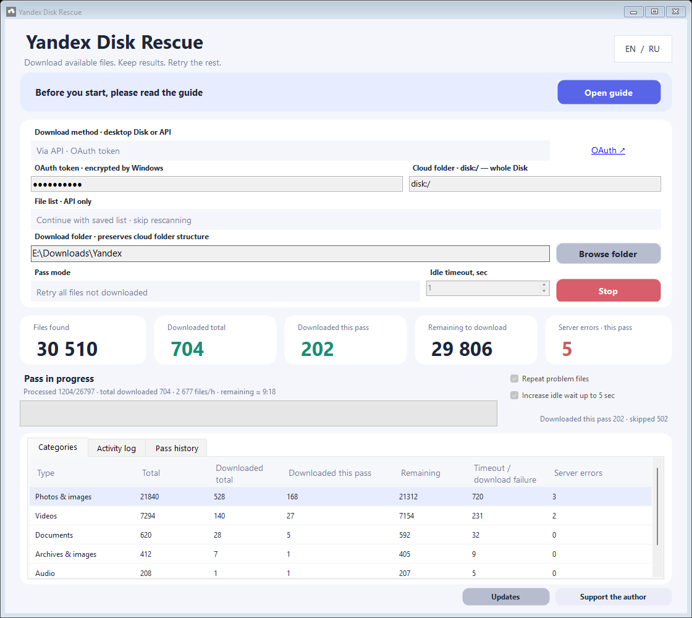

<div align="center">
  <p><strong>If this app helped you retrieve your files, you can support its author 💜</strong><br>Entirely optional. The app stays free.</p>
  <a href="https://yoomoney.ru/fundraise/1KS67440FP0.261012"></a>
</div>

<br>


<div align="center">

[](https://github.com/fefenke/Yandex-Disk-Rescue/actions/workflows/build.yml)
[](https://github.com/fefenke/Yandex-Disk-Rescue/releases/tag/v0.2.7)
[](LICENSE)

[Русский](README.md) · **English** · [Download](#download) · [Quick start](#quick-start) · [Help](#help)

</div>

A free portable Windows app that downloads available Yandex Disk files, keeps results and retries unsuccessful attempts. Choose OAuth API access or the official desktop client without entering a token.

> [!IMPORTANT]
> **Unlimited photo/video auto-upload files are NOT counted or downloaded.** Only files in the regular **Files** section are supported.

## Download

**Windows 64-bit · x64** — for most Windows 10/11 PCs.

[](https://github.com/fefenke/Yandex-Disk-Rescue/releases/download/v0.2.7/YandexDiskRescue-win-x64.zip)

**Windows 32-bit · x86** — for a 32-bit Windows installation.

[](https://github.com/fefenke/Yandex-Disk-Rescue/releases/download/v0.2.7/YandexDiskRescue-win-x86.zip)

Windows 10 **1709+** or Windows 11 · .NET Framework **4.7.1+** · RU / EN · no installer.

Extract the complete ZIP to a permanent folder and run **Start Yandex Disk Rescue.cmd**. Do not launch directly from the archive. [Current release notes](https://github.com/fefenke/Yandex-Disk-Rescue/releases/tag/v0.2.7).

## A look inside



*Screenshot uses demonstration data. Pass history stores results from each run.*

| Download without manual attempts | Keep your progress | See what is happening |
| --- | --- | --- |
| Up to five downloads; retry errors and timeouts | History by full path and version; valid local files are skipped | Downloaded total and this pass, remaining files, categories and pass history |

## Quick start

1. **Download and extract** the ZIP for your Windows architecture.
2. **Choose a method:** API or desktop client.
3. **Select a folder**, review the settings and press **Start pass**. The app's **Open guide** button explains all modes and combinations.

| API — selected by default | Official desktop client |
| --- | --- |
| Get an [OAuth token from Yandex](https://yandex.ru/dev/disk/poligon/) and enter it | Install [Yandex Disk](https://disk.yandex.ru/download), sign in and wait for synchronization |
| Select a **download destination**; `disk:/` means the whole Disk, `disk:/Photos` selects a folder | Select the **local Disk folder**, including subfolders; no token entry required |
| No client or restarts needed; API can be faster | The client may restart on synchronization errors |

Defaults: **cached inventory**, **retry all files not downloaded**, automatic retries and gradual idle-timeout increases. Missing inventory is created once. Refresh it when you add or change cloud files.

## Understand the settings

<details>
<summary><strong>Inventory and five pass modes</strong></summary>

The upper API selector chooses **where the file list comes from**; the lower selector chooses **which files to process**. Cached inventory avoids rescanning; unfinished scans resume. Automatic file retries do not refresh inventory on every pass.

| Mode | Files processed |
| --- | --- |
| Resume unfinished pass | Unchecked files and user-interrupted attempts |
| Retry server / sync errors | Recorded server or synchronization failures |
| Retry timeouts and failures | Zero-byte and partial transfers and other unsuccessful attempts |
| Retry all files not downloaded | All missing files, including unchecked and problem files |
| Start pass from the beginning | Entire inventory again; valid local files are not downloaded again |

**Normal use:** cached list + retry all files not downloaded. **After cloud changes:** refresh list + retry all files not downloaded.

</details>

<details>
<summary><strong>File retries, download idle timeout and API connection retries</strong></summary>

**Automatic file retries:** run the selected mode first, then problem files with a 30-second pause. An empty initial pass still proceeds to remaining problems. Stop cancels requests and waiting. No remaining candidates ends the loop.

**Idle timeout:** limits waiting without new data, not total download duration. Use 1 second for a quick pass or try 3–5 seconds for timeout retries. Short waits can cancel slow working transfers.

**Increase idle wait up to 5 sec:** enabled by default, available only with automatic retries. Every two completed nonempty passes increases the initial timeout by two seconds up to five.

| Initial | Passes 1–2 | Passes 3–4 | Later |
| --- | --- | --- | --- |
| 1 sec | 1 sec | 3 sec | 5 sec |
| 3 sec | 3 sec | 5 sec | 5 sec |
| 5 sec or more | Unchanged | Unchanged | Unchanged |

Each new session restarts the schedule. Connection failures, unfinished scans and empty passes do not increase waiting. The actual value appears in the interface and pass history. Without this checkbox, waiting stays constant.

**API connection and scanning:** independently retry temporary network errors and HTTP 408/429/5xx at the same folder and page. First retry is immediate, then 1/2/5-second pauses; server Retry-After is respected. Download idle timeout does not control these requests. Invalid tokens and denied access require attention.

</details>

<details>
<summary><strong>Statistics, partial files and updating the app</strong></summary>

**Remaining** means all files not downloaded; the current pass size depends on its mode. **Downloaded this pass** counts new successful downloads. Categories groups file types. Pass history stores start, duration, mode, idle timeout and outcome.

History, inventory and reports stay in `data` beside the EXE. **Preserve this folder when updating.** Files use full-path and version identity; identical names in different folders remain separate.

API verifies size and available MD5. `.ydr-part` partials are not successful downloads and restart on retry. Verified unchanged files reconcile faster; a full pass verifies them again.

</details>

## Token and security

API tokens are stored locally using **Windows DPAPI**, tied to your Windows user account. They are decrypted in memory for requests to Yandex and excluded from `settings.json`. Never publish `data` or show tokens in screenshots.

When access is no longer needed, revoke it in **Yandex ID → Data access**. [Yandex instructions](https://yandex.ru/dev/id/doc/ru/tokens/token-invalidate). Deleting a local token does not revoke it at the service. Use the desktop-client method if you prefer not to enter a token.

The code is open and you can build it yourself. This does not guarantee the absence of vulnerabilities: review the code and permissions before use.

## Help

[Report an issue](https://github.com/fefenke/Yandex-Disk-Rescue/issues/new) · [Release notes](RELEASE-NOTES.md) · [Support the author](https://yoomoney.ru/fundraise/1KS67440FP0.261012)

Include the app version, download method and exact error text. Remove **tokens and personal data** from screenshots.

<details>
<summary><strong>Build from source</strong></summary>

```powershell
powershell.exe -NoProfile -ExecutionPolicy Bypass -File .\build.ps1 -Package -Platform x64
```

Use `-Platform x86` for 32-bit. Offline checks: `tests/run-tests.ps1`. GitHub Actions checks both architectures.

</details>

---

**Independent, unofficial project. Not developed by or affiliated with Yandex.** Cannot restore deleted files, repair server errors or guarantee every download. Unlimited auto-upload is unsupported.

[MIT License](LICENSE) · Less manual work, more visible progress.
### Resuming partial downloads

API downloads resume nonempty `.ydr-part` files using HTTP Range when supported. Full responses restart the download. File size and available MD5 are checked before completion. Changed cloud versions cannot reuse old fragments; corrupt complete files are reset.

**Resume partial downloads · API** selects nonempty temporary files. Automatic retries remain in this mode; otherwise one pass runs. Failed attempts do not block other files. Resuming also works in other API modes. Windows and the official client manage downloads in client mode.

The activity log preserves selection and scrolling as events arrive. Reading earlier lines or selecting text suspends automatic scrolling.
