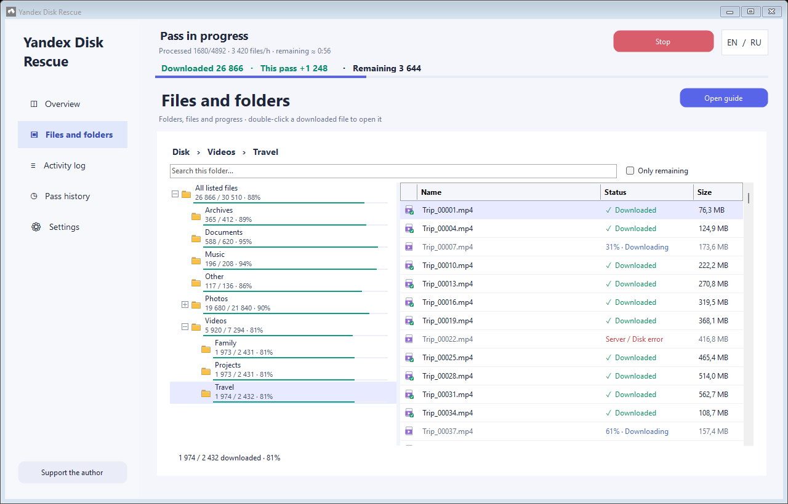



<strong>Did the app help retrieve your files? You can support the author 💜</strong> Optional. The app remains free.

[Русский](README.md) · **English** · [Full guide](https://github.com/fefenke/Yandex-Disk-Rescue/blob/main/GUIDE.en.md) · [1.0.7 changes](https://github.com/fefenke/Yandex-Disk-Rescue/blob/main/RELEASE-NOTES.md)

A free Windows app that downloads available files from Yandex Disk, retains progress and retries failed transfers. Uses Yandex Disk API technology or the official desktop client. An independent, unofficial project unaffiliated with Yandex.

> [!IMPORTANT]
> Only the regular **Files** section is supported. For photos stored only in unlimited auto-upload, use the Yandex Disk website to copy missing items into an ordinary folder, then refresh the app inventory. See the guide for quota and privacy details. The app cannot repair unavailable cloud originals or guarantee every download.

## Download

Windows **10 1709+ / 11**, .NET Framework **4.7.1+**, RU / EN, portable. Usually choose x64 for 64-bit Windows. x86 supports 32-bit Windows and also runs on x64.

Extract the **entire** ZIP to a permanent folder and run **YandexDiskRescue.exe**. Settings, encrypted token and history live in `data` beside the app. Keep it during updates and never publish it.

## Getting started

1. Open Settings. API is selected by default and does not need the desktop client.
2. Follow the app's OAuth link, sign into the intended account, obtain a token and enter it.
3. Choose an ordinary local destination. `disk:/` means the regular Disk section; `disk:/Photos` selects one folder.
4. Keep the saved-list option, choose **Retry all files not downloaded**, and start a pass. A missing list is fetched automatically.
5. Refresh the list after cloud changes; rescanning before every retry is unnecessary.

Alternatively, use the official desktop client: wait for synchronization and select its local Disk folder. No token is entered into this app; Windows and the client control transfers. HTTP resume and the new partial-data protection apply to API mode.

## New in 1.0.7

- Empty subfolders are automatically removed after service-archive cleanup.
- Update controls remain in Settings; interface screenshots have been refreshed.

How downloading works:

- **Retries after progress.** Up to two extra attempts after new bytes and a network interruption, using the same link and saved offset. Retries rejoin the connection queue. Idle timeout is the selected value +2 seconds for both retries, for example 3 → 5 → 5. No quick retries after zero new bytes, HTTP/MD5 failures or disk errors.
- **API rate handling.** A shared pacer honors `Retry-After` for 429, 408 and 5xx, reduces request frequency and gradually recovers. Ready-link downloads continue.
- **Links across passes.** Links proven by data remain in memory within one session. Rejection or no new bytes triggers fresh link acquisition on the next pass; no arbitrary expiry time is assumed.
- **Fresh version checks before resuming.** Query metadata for the individual started file, rather than rescanning the Disk. Failed checks preserve saved parts.
- **Crash recovery.** Each stream checkpoints every 32 MiB or 15 seconds while receiving data, and on attempt completion. SHA-256 journal checks discard corrupt or unconfirmed tails. Final size and available cloud MD5 are checked before promotion.

## Settings and saved data

| Setting | Default | Meaning |
| --- | --- | --- |
| Link timeout | 3 s | API response after request dispatch |
| File idle timeout | 3 s | Download response/new-byte wait, separately per stream |
| Link requests | 7 | Concurrent link tasks, range 1–30 |
| Download connections | 20 | Shared limit across files and parts, range 1–30 |
| API interval | 50 ms | Request launch spacing, range 25–1000 ms |
| Large-file streams | 4 from 256 MB | 1–8 streams; threshold 64–4096 MB; MB = 1,000,000 bytes |

Queueing and API pacing do not consume network timeout budgets. Continuous passes are enabled by default. More streams are not always faster, especially on HDDs. See the [guide](https://github.com/fefenke/Yandex-Disk-Rescue/blob/main/GUIDE.en.md) for examples.

Streams write into one `.ydr-download` payload with confirmed extents in `.ydr-map`. Keep both until completion. Legacy parts migrate after map validation. NTFS needs no final merge; drives without sparse support retain the legacy format.

## Validation and limitations

Full x64/x86 self-tests cover timeouts, queueing, Stop, byte ranges, MD5, version changes, corrupted parts and torn journals. SATA HDD/NTFS tests additionally killed the process during downloading and merging, then verified the final MD5. Physical power removal was not tested; durability depends on the drive honoring flush requests.

One local 2 GiB write test took 77.9 s without checkpoints and 84.9 s with them: +7.0 s, about 9%. This synthetic test under a particular workload does not predict internet speed or other HDD performance.

Verification checks size, then MD5, or SHA-256 only if MD5 is absent. Missing both hashes is explicitly marked as size-only evidence. Existing files are archived before replacement. Bad new copies are preserved and their cloud version is blocked from automatic retries even if the artifact is deleted. Explicit retry has its own mode; changed cloud versions remain eligible. See the guide.

## Updates, builds and support

In-app updates validate the architecture-specific ZIP against GitHub SHA-256 and retain `data`. Installation requires confirmation while idle. For a manual update, close the app, retain `data` and replace application files.

Build: `powershell -NoProfile -ExecutionPolicy Bypass -File build.ps1 -Package -Platform x64`. Substitute x86 as needed. Checks: `powershell -NoProfile -ExecutionPolicy Bypass -File tests/run-tests.ps1`. Requires Windows and .NET Framework 4.7.1+. Self-tests use synthetic network responses.

[All releases](https://github.com/fefenke/Yandex-Disk-Rescue/releases) · [Report an issue](https://github.com/fefenke/Yandex-Disk-Rescue/issues) · [MIT license](LICENSE) · [Yandex Disk API terms](https://yandex.ru/legal/disk_api/ru/)

## Design and privacy

Separate link/download queues keep other files moving when a server stalls. Network idle timeouts exclude local writes; connections, streams, pacing and timeouts can be adjusted for the network and HDD. More streams are not always faster. Preserved copies, extent maps and cloud checksums address different failure modes. See [design decisions](DESIGN-DECISIONS.md) and the [test matrix](TESTING.md).

API downloads do not require public links. Do not publish private data or paste links/tokens into untrusted sites: recipients may copy or share the content. The source is open; downloads/history run locally, with Yandex requests and GitHub update checks. No project-operated relay receives your files. Windows DPAPI protects the saved token for the current Windows user, not downloaded files or reports. It does not defeat malware running as that user. After backup, revoke the application's access in [Yandex ID](https://id.yandex.ru/security), then clear the local token; local deletion alone does not revoke remote access.
