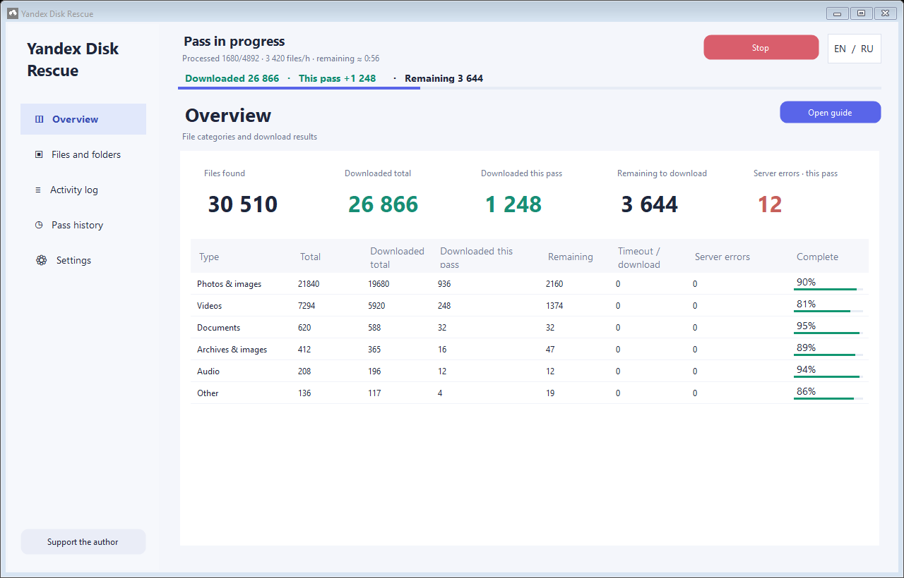

# Yandex Disk Rescue
**Important: photos and videos stored through unlimited auto-upload are not counted or downloaded, in either desktop-client or API mode. Only files in the regular Files section are supported.**


[](https://github.com/fefenke/Yandex-Disk-Rescue/releases/download/v0.2.0/YandexDiskRescue-win-x64.zip)
[](https://github.com/fefenke/Yandex-Disk-Rescue/releases/download/v0.2.0/YandexDiskRescue-win-x86.zip)

Extract the complete ZIP and run **Start Yandex Disk Rescue.cmd**.

[Русский](README.md) · Windows x64 · portable app · version 0.2.0, preview

Download accessible cloud files from a local Yandex Disk folder and its subfolders, keep results, and retry unsuccessful attempts. The app uses Windows Cloud Files directly: it does not open Explorer, launch file viewers, or send keyboard input.

This is an independent community project, not an official Yandex product. It cannot restore deleted files or repair server-side errors. Downloads depend on the installed Yandex Disk client and service.



## Two download methods

API mode uses a Yandex OAuth token and downloads directly, without the desktop client or client restarts. It can therefore process files faster, particularly when desktop synchronization fails. Actual throughput depends on the connection and service.

Get an OAuth token from the [Yandex Disk API Playground](https://yandex.ru/dev/disk/poligon/). Disk read access is required.

Choose **Via Yandex Disk client** and the local Disk folder, or **Via API** and an OAuth token, an existing ordinary local download folder, and a cloud path. disk:/ means the whole Disk. API mode needs Disk read access, does not require the desktop client, and never restarts it. Missing required fields prevent a pass from starting.

Both methods use up to five active downloads. API requests with no progress are cancelled; errors are recorded and the next files are attempted. Partials use .ydr-part and restart from the beginning on a later attempt. Success requires matching size and matching MD5 when available. A failed integrity check does not replace an existing final file.

API history is separate and scoped to the account, cloud root and download destination. Zero-download retry selects only previously cancelled files with zero received bytes. Server-error retry selects previous HTTP 5xx failures.

Tokens are masked and stored using Windows DPAPI for the current user in data/api-token.bin. They are excluded from settings JSON, logs and reports, and never forwarded to signed download URLs. Right-click the token field and choose Clear token to remove the saved credential. It cannot be decrypted under another user's Windows profile.

API behavior was tested with simulated server responses, without a real account. Unlimited auto-upload is unsupported in both methods.

## Before you start with the Disk client

1. Use Windows 10 version 1709 or later (32/64-bit) or Windows 11 (64-bit). .NET Framework 4.7.1 or newer is included in supported Windows versions. Use x86 for 32-bit Windows 10 and x64 for 64-bit Windows. Windows 7/8 and native ARM64 builds are not supported.
2. Install [Yandex Disk for Windows](https://disk.yandex.ru/download), sign in, and wait for its local folder to appear. Wait for Yandex Disk synchronization to finish before starting a pass.
3. Files must exist in the regular **Files** section of Yandex Disk and be visible in its local folder, including cloud-only placeholders.
4. **Unlimited photo/video auto-upload is not supported.** Items available only through the photo/auto-upload view, without corresponding regular files in the local Disk folder, cannot be discovered.
5. Stop other download scripts and ensure adequate disk space. Close old Explorer transfer dialogs.
6. Extract the portable ZIP to a writable folder. For the first launch use `Start Yandex Disk Rescue.cmd`, which checks Windows, architecture and .NET **before** starting the EXE. Afterwards you can run `YandexDiskRescue.exe` directly. Keep `YandexDiskRescue.exe.config` beside it.

The app checks Windows Cloud Files and whether the Disk client is installed/running. It offers the official download page if the client is missing, or offers to launch it if installed but stopped. It does not install software or change system settings automatically. An external launcher is necessary because a .NET-dependent EXE cannot check its own prerequisite before the runtime loads. If .NET is missing or damaged, the launcher displays the official installer link.

## Usage

Choose the local Disk folder and a pass mode, then click **Start pass**. Monitoring starts automatically, and the button becomes **Stop**. Stopping prevents new requests, cancels active requests, and saves results. Closing the app uses the same shutdown procedure.

Switch between Russian and English with **RU / EN**. The monitor displays total downloaded files, downloads in the current pass, throughput, and approximate remaining time. Monitoring ends when the pass completes or stops.

| Mode | Behavior |
|---|---|
| Continue | Processes new and unprocessed files. Previous completed attempts, including failures and timeouts, are skipped; Stop-interrupted requests are retried. API saved-list mode avoids cloud-folder enumeration. |
| Recheck everything | Checks all currently discovered files. Local files remain in place and are not downloaded again. History is not deleted. |
| Retry sync errors only | Retries unchanged files whose latest confirmed result is `0x80070185`. |
| Only files with zero downloaded bytes | Retries only previously checked and cancelled files of the same version with zero downloaded bytes. New files, sync errors, partial downloads and unknown hydration states are skipped. |

Every pass rescans the directory tree. Records use **full path, file size, and modification time**. Identical names in separate folders are independent. Moving a file creates a new identity at its new path.

## Results and reports

- **Available**: already local, or the full hydration request succeeded. It does not mean the contents were verified or opened in a viewer.
- **Downloaded this pass**: successful new hydration requests in the current run.
- **Zero download**: previously cancelled files with zero received bytes; **Remaining** includes all files not fully available locally. Timeouts do not prove permanent unavailability.
- **Sync errors · this pass**: unique files returning 0x80070185 during this pass. This counter never decreases within a pass and resets for the next pass.

Photos/images, videos, documents, archives/disk images, audio, and other files are counted separately. Unknown extensions are included. Executables are downloaded as data and are never launched.

History and preferences are stored in `data` beside the executable, with separate journals for each root folder. Each result is saved immediately. Keep `data` to preserve progress between launches.

Reports are saved automatically under data: files.csv, categories.csv, folders.csv and summary.json. There is no Open reports button. Folder scope direct counts immediate files; tree counts descendants. Overlapping tree rows must not be summed.

Categories display downloaded total, downloaded this pass, remaining files, previously checked and cancelled files with zero downloaded bytes, and current sync errors. Current category errors can decrease when a later attempt changes the result.

During a pass the app repeatedly restarts Yandex Disk whenever sync errors occur. Ten ordinary idle cancellations do not cause a restart. Restart cannot be disabled in the interface.

## Settings and limitations

- Up to five concurrent requests; the limit is fixed.
- Default idle timeout: **one second without increasing hydrated byte count**, not a limit on total download duration. Increase it for slow connections.
- Requests are cancelled through `CancelIoEx`, and completion is checked. If cancellation is not acknowledged, the pass stops and further passes in that app process are disabled. Restart Yandex Disk and the app before retrying.
- Cancelling an app request **does not guarantee clearing autonomous tasks inside the Yandex client**. This app does not inspect or control the client's private queue.
- Client restart is mandatory: after `0x80070185`, the app waits for its requests to finish and restarts the client. Other client synchronization can be interrupted.
- Access errors are recorded. Ordinary directory symlinks/junctions are skipped; cloud placeholder folders are traversed.
- This preview has offline/local-file checks and Cloud Files compatibility verification. Complete GUI download runs with different client versions still require user testing.
- The binary is unsigned; Windows may show an unknown-publisher warning.

The app does not request OAuth tokens or upload logs. Windows delegates transfers to the installed client. Logs contain local paths: **do not publish `data`**.

## Build and test

No NuGet packages or .NET SDK are needed. The build uses the installed .NET Framework compiler.

```powershell
powershell.exe -NoProfile -ExecutionPolicy Bypass -File .\build.ps1 -Package
powershell.exe -NoProfile -ExecutionPolicy Bypass -File .\tests\run-tests.ps1
```

Executable: `dist\YandexDiskRescue\YandexDiskRescue.exe`.

Portable ZIP: `dist\YandexDiskRescue-win-x64.zip`.

Offline checks cover full-path identity, file versions, pass filters, retry order, history persistence, categories, metadata probes, local execution, reports, and error handling. They do not hydrate cloud files or restart the client.

GitHub Actions builds the ZIP and runs offline checks on Windows. Create a repository from this directory and attach the ZIP to a Release separately; no repository or release is published automatically. Keep personal `data` out of the repository.

## Technical basis

Windows [CfHydratePlaceholder](https://learn.microsoft.com/en-us/windows/win32/api/cfapi/nf-cfapi-cfhydrateplaceholder), [CfGetPlaceholderInfo](https://learn.microsoft.com/en-us/windows/win32/api/cfapi/nf-cfapi-cfgetplaceholderinfo), and [CancelIoEx](https://learn.microsoft.com/en-us/windows/win32/api/ioapiset/nf-ioapiset-cancelioex). API mode uses the Yandex Disk HTTPS REST API.

License: [MIT](LICENSE).

Support the author: [ЮMoney](https://yoomoney.ru/fundraise/1KS67440FP0.261012). The Support the author button opens this page in your browser; payments are made by you on the ЮMoney website.

API file-list selection: Refresh list from Disk discovers new or changed files; Use saved list skips cloud-folder enumeration. A missing list triggers the first scan. Lists are scoped to the account and cloud folder and can be reused with a different destination. Partial inventories and pagination positions are checkpointed; saved-list mode resumes interrupted scans from the checkpoint; lists with folder errors are marked incomplete.

The app always opens with the desktop Disk client selected. Switch to API when needed. API defaults to Continue with saved list; missing or unfinished scans are created or resumed. Choose Refresh list from Disk to discover new or changed files.

API Continue processes new or unprocessed files. Previous successes, failures and idle timeouts count toward cumulative Processed progress and are not retried. Requests interrupted by Stop are retried. Use the dedicated retry modes or Recheck everything for intentional retries.

The x86 build was tested in a 32-bit process on 64-bit Windows. Full testing on a separate 32-bit Windows installation and its Disk client remains necessary.
