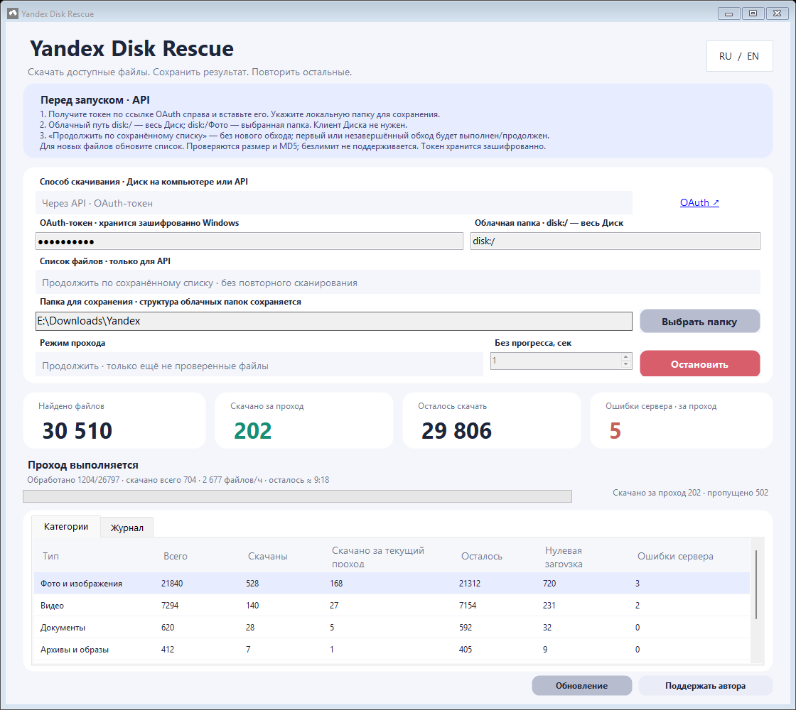



<strong>Приложение помогло забрать файлы? Можно поддержать автора 💜</strong> Это необязательно. Приложение остаётся бесплатным.

**Русский** · [English](README.en.md) · [Подробный гайд](https://github.com/fefenke/Yandex-Disk-Rescue/blob/main/GUIDE.md) · [Изменения 1.1.0](https://github.com/fefenke/Yandex-Disk-Rescue/blob/main/RELEASE-NOTES.md)

Бесплатное приложение для Windows, которое скачивает доступные файлы с Яндекс Диска, сохраняет прогресс и повторяет неудачные попытки. Использует технологию API Яндекс Диска. Независимый неофициальный проект, не связанный с Яндексом.

**Для скачивания файлов через API подписка Яндекс 360 не нужна.** Нужны аккаунт Яндекса и OAuth-токен.

> [!IMPORTANT]
> Программа обходит обычные **папки Диска**. Если нужные фото есть только в безлимитной автозагрузке, сначала скопируйте отсутствующие в папках файлы через сайт Яндекс Диска в обычную папку, затем обновите список в программе. Подробнее — в [гайде](GUIDE.md#фотографии-из-безлимитной-автозагрузки). Программа не исправляет недоступные облачные оригиналы и не гарантирует скачивание каждого файла.

## Скачать

Windows **10 1709+ / 11**, .NET Framework **4.7.1+**, RU / EN, без установки. Для 64-битной Windows обычно выбирайте x64; x86 предназначен для 32-битной Windows и также работает на x64.

Распакуйте ZIP **целиком** в постоянную папку и запустите **YandexDiskRescue.exe**. **Start Yandex Disk Rescue.cmd** — дополнительный запуск с проверкой Windows и .NET и понятным сообщением, если окружение не подходит. Настройки, зашифрованный токен и история находятся в папке `data` рядом с программой. Не публикуйте её и сохраняйте при обновлении.

## Начало работы

1. Откройте «Настройки». Скачивание работает через API; устанавливать клиент Яндекс Диска не нужно.
2. Получите токен по OAuth-ссылке в приложении, войдя в нужный аккаунт, и вставьте его в поле.
3. Выберите обычную локальную папку сохранения. `disk:/` означает весь обычный раздел Диска; `disk:/Фото` — выбранную папку.
4. Оставьте сохранённый список и выберите **«Повторить все нескачанные»**, затем начните проход. В первый раз список будет получен автоматически.
5. После изменений в облаке обновите список. Перед каждым повтором пересканирование не требуется.

## Что изменилось в 1.1.0

- Ускорена подготовка повторных проходов: убраны лишние обращения к служебным настройкам для каждого файла.
- Добавлено однократное обновление отклонённой ссылки в текущем проходе с продолжением сохранённых частей.

Как работает загрузка:

- **Повторы после прогресса.** После новых байтов и сетевого обрыва — до двух дополнительных попыток по той же ссылке с продолжением данных. Они заново встают в очередь соединений. Таймаут повторов: выбранный +2 секунды, например 3 → 5 → 5. Без новых байтов, при HTTP/MD5/ошибке записи быстрых повторов нет.
- **Уважение ограничений API.** Общий ограничитель учитывает `Retry-After` при 429, 408 и 5xx, временно снижает частоту запросов и восстанавливает её после успешной работы. Готовые загрузки продолжаются.
- **Ссылки между проходами.** Подтверждённая данными ссылка хранится в памяти одной серии. При HTTP 401/403/410 программа один раз обновляет ссылку после проверки облачной версии и продолжает оставшиеся части. Другие отказы остаются для следующего подходящего прохода; произвольный срок жизни не задаётся.
- **Проверка облачной версии перед докачкой.** Запрашиваются сведения конкретного начатого файла, а не весь список. При ошибке проверки сохранённые части остаются.
- **Восстановление после сбоя.** Каждый поток фиксирует данные каждые 32 МиБ или 15 секунд при поступлении данных, а также при завершении попытки. SHA-256 журнала позволяет отбросить повреждённый или неподтверждённый хвост. После загрузки проверяются размер и доступный облачный MD5 либо SHA-256.

## Настройки и сохранённые данные

| Настройка | По умолчанию | Что означает |
| --- | --- | --- |
| Ожидание ссылки | 3 с | Ответ API после отправки запроса |
| Без данных файла | 3 с | Ожидание ответа скачивания и новых байтов, отдельно для каждого потока |
| Запросы ссылок | 7 | Одновременные задачи получения ссылок, диапазон 1–30 |
| Соединения скачивания | 20 | Общий лимит всех файлов и частей, диапазон 1–30 |
| Интервал API | 50 мс | Интервал запусков запросов, диапазон 25–1000 мс |
| Потоки крупного файла | 4 от 256 МБ | 1–8 потоков; порог 64–4096 МБ; МБ = 1 000 000 байт |

Ожидание очереди и ограничителя API не расходует сетевой таймаут. Бесконечные проходы включены по умолчанию. Больше потоков не обязательно быстрее, особенно на HDD. Подробности и примеры — в [гайде](https://github.com/fefenke/Yandex-Disk-Rescue/blob/main/GUIDE.md).

Все потоки пишут в один `.ydr-download`, а подтверждённые участки хранятся в `.ydr-map`. Не удаляйте их до завершения. Старые части переносятся после проверки карты. На NTFS отдельная сборка не требуется; без поддержки sparse остаётся прежний формат.

## Проверки и ограничения

Полные самопроверки x64/x86 покрывают таймауты, очереди, остановку, диапазоны, MD5, смену версии, повреждение частей и оборванные журналы. На SATA HDD/NTFS дополнительно проверены принудительное завершение процесса во время загрузки и сборки и правильность результата по MD5. Физическое отключение питания не проводилось; сохранность зависит от накопителя и выполнения команд записи.

В одном локальном тесте запись 2 ГиБ заняла 77,9 с без контрольных точек и 84,9 с с ними: +7,0 с, около 9%. Это синтетическая запись при конкретной нагрузке, не прогноз скорости интернета или любого HDD.

Проверка: размер → MD5, а при отсутствии MD5 → SHA-256. Без обоих облачных хешей результат отмечается проверенным только по размеру. Перед заменой прежние файлы сохраняются в отдельные папки. Ошибочная новая копия также сохраняется; эта версия не скачивается снова автоматически, даже если её копию удалить. Ручной повтор — отдельный режим; новая облачная версия разрешена.

## Обновление, сборка и связь

Встроенное обновление проверяет ZIP нужной архитектуры по SHA-256 из GitHub и сохраняет `data`. Установка выполняется с подтверждением, когда проход остановлен. При ручном обновлении закройте программу, сохраните `data` и замените файлы приложения.

Сборка: `powershell -NoProfile -ExecutionPolicy Bypass -File build.ps1 -Package -Platform x64`. Для x86 замените архитектуру. Проверки: `powershell -NoProfile -ExecutionPolicy Bypass -File tests/run-tests.ps1`. Нужны Windows и .NET Framework 4.7.1+; сетевые запросы в самопроверках подменяются синтетическими ответами.

[Все релизы](https://github.com/fefenke/Yandex-Disk-Rescue/releases) · [Сообщить о проблеме](https://github.com/fefenke/Yandex-Disk-Rescue/issues) · [Лицензия MIT](LICENSE) · [Условия API Яндекс Диска](https://yandex.ru/legal/disk_api/ru/)

## Почему устроено именно так

Раздельные очереди ссылок и скачиваний помогают продолжать работу, пока отдельный сервер не отвечает. Таймаут измеряет отсутствие сетевых данных, а запись на HDD не расходует его бюджет. Потоки, подключения, интервал API и таймауты настраиваются под вашу сеть и диск. Больше потоков не всегда быстрее: на HDD часто разумнее меньше параллельных записей.

Прежние копии сохраняются перед заменой; карта проверяет сохранённые участки после сбоя; облачный хеш проверяет целый файл. Ошибочная версия не скачивается бесконечно. Дерево папок, журнал и история позволяют увидеть результат и продолжить работу. Подробное объяснение решений и компромиссов — в [устройстве проекта](DESIGN-DECISIONS.md), проверки по аспектам — в [отчёте тестирования](TESTING.md).

## Приватность и завершение работы

Публичные ссылки для API-загрузки не нужны. Не публикуйте личные файлы ради скачивания и не вставляйте ссылки или токены в непроверенные сервисы: получатель может сохранить данные и передать доступ дальше. Исходники открыты; скачивание и хранение истории выполняются на вашем компьютере, запросы идут к Яндексу, проверка обновлений — к GitHub. Промежуточного сервера проекта для ваших файлов нет.

Сохранённый OAuth-токен защищён Windows DPAPI для текущего пользователя. Файлы, история и отчёты автоматически не шифруются; открытый код и DPAPI не защищают от вредоносной программы, работающей под вашим пользователем. После завершения бэкапа отзовите доступ приложения в [Яндекс ID](https://id.yandex.ru/security), затем очистите токен в программе. Удаление локального токена само по себе не отзывает разрешение на стороне Яндекса.
