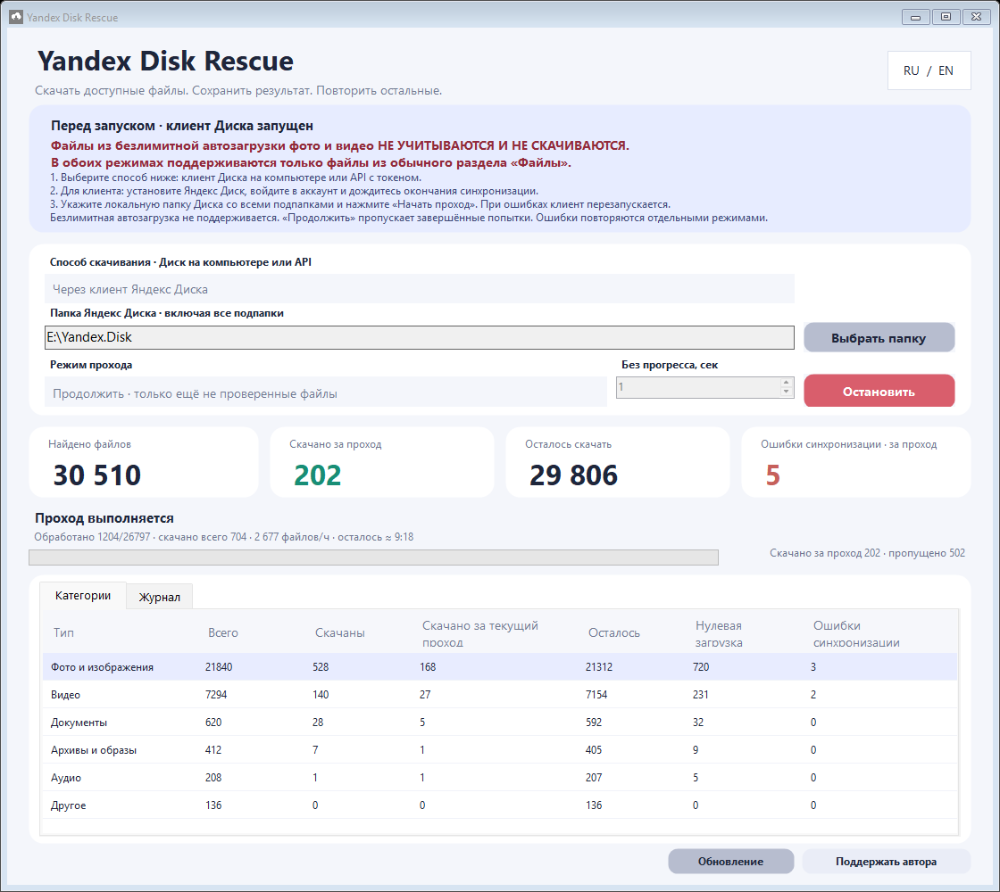

# Yandex Disk Rescue

[English](README.en.md) · Windows x64 · портативное приложение · версия 0.1.0, предварительная

Приложение проходит по локальной папке Яндекс Диска и подпапкам, запрашивает скачивание облачных файлов без открытия Проводника или просмотрщиков, сохраняет результаты и позволяет повторять неудачные попытки.

Это независимый проект, не официальный продукт Яндекса. Он не восстанавливает удалённые файлы и не исправляет серверные ошибки. Успешность скачивания зависит от клиента и сервиса Яндекс Диска.



## Перед запуском

1. Используйте Windows 10 версии 1709 или новее / Windows 11, x64. Требуется .NET Framework 4.7.1 или новее: он уже входит в поддерживаемые версии Windows. Windows 7/8, 32-битные системы и ARM64-сборки не поддерживаются этим архивом.
2. Установите [Яндекс Диск для Windows](https://disk.yandex.ru/download), войдите в аккаунт и дождитесь появления локальной папки Диска. Перед запуском прохода дождитесь окончания синхронизации Яндекс Диска.
3. Нужные файлы должны находиться в обычном разделе **«Файлы»** Яндекс Диска и отображаться в локальной папке, в том числе как облачные файлы.
4. **Безлимитная автозагрузка фото и видео не поддерживается.** Если материалы доступны только в разделе фото/автозагрузки и не представлены обычными файлами локальной папки, приложение их не увидит.
5. Остановите другие скрипты скачивания. Убедитесь, что на диске хватает свободного места. Закройте оставшиеся диалоги передач Проводника.
6. Распакуйте портативный ZIP в доступную для записи папку. Для первого запуска используйте `Start Yandex Disk Rescue.cmd`: он проверяет Windows, разрядность и .NET **до** запуска EXE. Затем можно открывать `YandexDiskRescue.exe` напрямую. Сохраните рядом `YandexDiskRescue.exe.config`.

Приложение проверяет системный Cloud Files и наличие/запуск клиента Диска. Если клиент не найден, предложит официальную страницу установки; если установлен, но не запущен — предложит его открыть. Автоматически устанавливать программы или изменять системные настройки оно не будет. Внешний запускатель нужен потому, что при отсутствующем .NET зависимый от него EXE ещё не может выполнить собственную проверку. При повреждённом или удалённом .NET запускатель показывает ссылку на официальный установщик.

## Использование

Выберите локальную папку Диска, режим прохода и нажмите **«Начать проход»**. Включится мониторинг, а кнопка сменится на **«Остановить»**. Остановка прекращает запуск новых запросов, отменяет активные и сохраняет результаты. При закрытии окна действует тот же порядок.

Интерфейс переключается кнопкой **RU / EN**. Мониторинг показывает общее число скачанных файлов, результат текущего прохода, скорость и приблизительное оставшееся время. После завершения или остановки мониторинг завершается вместе с проходом.

| Режим | Поведение |
|---|---|
| Продолжить | Заново сканирует папку, обрабатывает новые и изменённые файлы, пропускает ранее успешные, если они остаются локальными. Старые неудачные идут в конце. |
| Проверить всё заново | Повторно проверяет все текущие файлы. Локальные файлы остаются на месте и не скачиваются повторно. История не удаляется. |
| Только ошибки синхронизации | Повторяет неизменённые файлы с последним подтверждённым результатом `0x80070185`. |
| Только файлы с нулевой загрузкой | Повторяет только ранее проверенные и отменённые файлы той же версии с нулём скачанных байтов. Новые файлы, ошибки синхронизации, частичные загрузки и неизвестное состояние пропускаются. |

В следующем проходе в любом режиме папка сканируется заново. Идентичные имена в разных папках считаются разными файлами: история использует **полный путь, размер и время изменения**. Перемещённый файл считается новым по новому пути.

## Результаты

- **Доступны**: файл локальный либо запрос полного скачивания завершился успешно. Это не проверка целостности изображения/видео и не запуск просмотрщика.
- **Скачано за проход**: новые успешные системные запросы текущего запуска.
- **Отложено**: таймаут без прогресса, другая ошибка или отмена при остановке. **Таймаут не доказывает, что файл невозможно скачать или что он потерян.** Очередь самого клиента тоже может задерживать передачу.
- **Ошибки синхронизации · за проход**: число уникальных файлов с ошибкой 0x80070185 в текущем проходе. Счётчик не уменьшается и начинается заново при следующем проходе.

Фото/изображения, видео, документы, архивы/образы, аудио и остальные файлы сгруппированы отдельно. Неизвестные расширения не исключаются. Исполняемые файлы скачиваются как данные и никогда не запускаются.

История и настройки хранятся рядом с EXE в папке `data`. Каждая выбранная корневая папка имеет отдельный журнал. Результат записывается после каждого обработанного файла. Не удаляйте `data`, если хотите сохранять прогресс между запусками.

Отчёты сохраняются автоматически в data, в каталоге выбранной папки: files.csv, categories.csv, folders.csv и summary.json. Кнопки открытия отчётов нет. В folders.csv direct — файлы непосредственно в папке, tree — всё поддерево; строки tree нельзя суммировать.

В категориях: «Скачаны» — полностью доступные локально файлы, включая прошлые проходы; «Скачано за текущий проход» — новые успешные скачивания; «Осталось» — все ещё не скачанные; «Нулевая загрузка» — ранее проверенные и отменённые без скачанных байтов; «Ошибки синхронизации» — файлы с таким последним результатом. Последний показатель может уменьшаться после новых попыток.

Во время прохода приложение будет многократно перезапускать Яндекс Диск, если возникают ошибки синхронизации. После десяти обычных отмен по таймауту перезапуска нет. Галка отключения перезапусков отсутствует.

## Настройки и ограничения

- Одновременно выполняются до 5 независимых запросов; количество фиксировано.
- Таймаут — **1 секунда без прироста данных**, а не общее время скачивания. Для медленного соединения увеличьте его.
- Отмена отправляется через `CancelIoEx`. Приложение ждёт её завершения. Если Windows не подтверждает отмену, проход останавливается, и новый проход в этом процессе запрещается: перезапустите клиент Диска и приложение.
- Подтверждение отмены системного запроса **не гарантирует очистку внутренних задач клиента**, запущенных им независимо. Приложение не считывает и не управляет внутренней очередью Яндекс Диска.
- Перезапуск клиента обязателен: после `0x80070185` приложение дожидается завершения своих запросов и перезапускает клиент. Это может прервать другую синхронизацию Диска.
- При разборе папок ошибки доступа записываются в журнал; обычные символические ссылки и junction не обходятся. Облачные папки обходятся.
- Первая версия протестирована на Windows с поддержкой Cloud Files и на локальных файлах. Полный интерфейсный проход с разными версиями клиента пока требует пользовательского тестирования.
- Сборка не подписана сертификатом. Windows может показать предупреждение о неизвестном издателе.

Программа не запрашивает OAuth-токены и не отправляет журналы на внешний сервер. Перед скачиванием она обращается к системному интерфейсу Windows, а передачу выполняет установленный клиент Диска. Журналы содержат ваши локальные пути: **не публикуйте папку `data`**.

## Сборка и проверка

Дополнительных NuGet-пакетов и .NET SDK не требуется. Компилятор берётся из установленного .NET Framework.

```powershell
powershell.exe -NoProfile -ExecutionPolicy Bypass -File .\build.ps1 -Package
powershell.exe -NoProfile -ExecutionPolicy Bypass -File .\tests\run-tests.ps1
```

EXE: `dist\YandexDiskRescue\YandexDiskRescue.exe`.

Портативный архив: `dist\YandexDiskRescue-win-x64.zip`.

Проверки работают на временных локальных файлах: идентификация по полному пути, изменение версии файла, четыре режима, порядок повторных попыток, история, категории, отчёты и обработка ошибок. Они не скачивают ваши облачные файлы и не перезапускают клиент.

GitHub Actions собирает ZIP и запускает проверки на Windows. Репозиторий можно создать из этой папки. Публикация репозитория и релизов выполняется отдельно; автоматической публикации приложение не делает. Для Release приложите ZIP, не `data`.

## Техническая основа

Используется локальный Windows Cloud Files API: [CfHydratePlaceholder](https://learn.microsoft.com/en-us/windows/win32/api/cfapi/nf-cfapi-cfhydrateplaceholder), [CfGetPlaceholderInfo](https://learn.microsoft.com/en-us/windows/win32/api/cfapi/nf-cfapi-cfgetplaceholderinfo), [CancelIoEx](https://learn.microsoft.com/en-us/windows/win32/api/ioapiset/nf-ioapiset-cancelioex). HTTP API Яндекс Диска не используется.

Лицензия: [MIT](LICENSE).

Поддержать автора: [ЮMoney](https://yoomoney.ru/fundraise/1KS67440FP0.261012). Кнопка «Поддержать автора» открывает эту страницу в браузере; перевод выполняется только вами на сайте ЮMoney.
