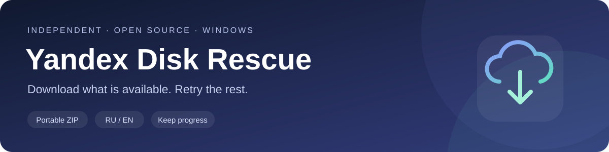
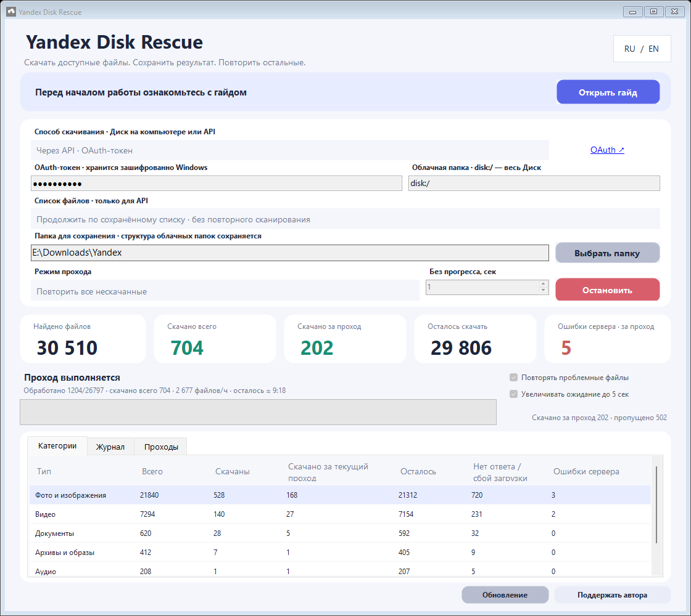

<div align="center">
  <p><strong>Если приложение помогло забрать файлы — можно поддержать автора 💜</strong><br>Это необязательно. Приложение остаётся бесплатным.</p>
  <a href="https://yoomoney.ru/fundraise/1KS67440FP0.261012"></a>
</div>

<br>



<div align="center">

[](https://github.com/fefenke/Yandex-Disk-Rescue/actions/workflows/build.yml)
[](https://github.com/fefenke/Yandex-Disk-Rescue/releases/tag/v0.2.6)
[](LICENSE)

**Русский** · [English](README.en.md) · [Скачать](#скачать) · [Быстрый старт](#быстрый-старт) · [Помощь](#помощь)

</div>

Бесплатное портативное приложение для Windows: скачивает доступные файлы с Яндекс Диска, сохраняет результаты и повторяет неудачные попытки. Два способа работы — через API с токеном или через официальный клиент Диска без ввода токена.

> [!IMPORTANT]
> **Файлы безлимитной автозагрузки фото и видео НЕ учитываются и НЕ скачиваются.** Поддерживаются только файлы обычного раздела **«Файлы»**.

## Скачать

**Windows 64-бит · x64** — для большинства компьютеров с Windows 10/11.

[](https://github.com/fefenke/Yandex-Disk-Rescue/releases/download/v0.2.6/YandexDiskRescue-win-x64.zip)

**Windows 32-бит · x86** — если установлена 32-битная Windows.

[](https://github.com/fefenke/Yandex-Disk-Rescue/releases/download/v0.2.6/YandexDiskRescue-win-x86.zip)

Windows 10 **1709+** или Windows 11 · .NET Framework **4.7.1+** · RU / EN · без установки.

Полностью распакуйте ZIP в постоянную папку и запустите **Start Yandex Disk Rescue.cmd**. Не запускайте программу прямо из архива. [Описание текущего выпуска](https://github.com/fefenke/Yandex-Disk-Rescue/releases/tag/v0.2.6).

## Как выглядит



*Скриншот с демонстрационными данными. Вкладка «Проходы» сохраняет итоги каждого запуска.*

| Скачать без ручного перебора | Продолжить с результатами | Понять, что происходит |
| --- | --- | --- |
| До пяти загрузок одновременно, повторы ошибок и таймаутов | История по полному пути и версии файла; корректные скачанные файлы пропускаются | Скачано всего и за проход, осталось, категории и статистика проходов |

## Быстрый старт

1. **Скачайте и распакуйте** ZIP для своей Windows.
2. **Выберите способ:** API или клиент Диска.
3. **Укажите папку**, проверьте настройки и нажмите **«Начать проход»**. Подробная инструкция доступна по кнопке **«Открыть гайд»** в приложении.

| Через API — выбран по умолчанию | Через официальный клиент |
| --- | --- |
| Получите [OAuth-токен на странице Яндекса](https://yandex.ru/dev/disk/poligon/) и вставьте его в приложение | Установите [Яндекс Диск](https://disk.yandex.ru/download), войдите в аккаунт и дождитесь окончания синхронизации |
| Выберите папку **для сохранения**; `disk:/` означает весь Диск, `disk:/Фото` — отдельную папку | Выберите **локальную папку Диска**, включая подпапки; вводить токен не требуется |
| Клиент не нужен; API может быть быстрее, поскольку не требует его перезапусков | При ошибках синхронизации клиент может перезапускаться |

По умолчанию используются **сохранённый список**, **«Повторить все нескачанные»**, автоповтор и постепенное увеличение ожидания. Если списка ещё нет, он создаётся один раз. Обновляйте список, когда добавили или изменили файлы в облаке.

## Настройки без путаницы

<details>
<summary><strong>Список файлов и пять режимов прохода</strong></summary>

Верхний выбор API задаёт **источник списка**, нижний — **какие файлы обрабатывать**. Сохранённый список не требует нового обхода; незавершённый скан продолжается. Автоповтор не обновляет список на каждом проходе.

| Режим | Что делает |
| --- | --- |
| Продолжить незавершённый проход | Берёт непроверенные файлы и прерванные пользователем попытки |
| Повторить ошибки сервера / синхронизации | Повторяет файлы с такими записанными ошибками |
| Повторить таймауты и сбои | Повторяет нулевые и частичные загрузки, другие неуспешные попытки |
| Повторить все нескачанные | Берёт все нескачанные, включая непроверенные и проблемные |
| Начать проход с нуля | Проходит весь список заново; корректные локальные файлы не скачиваются повторно |

**Обычный запуск:** сохранённый список + повторить все нескачанные. **После изменений в облаке:** обновить список + повторить все нескачанные.

</details>

<details>
<summary><strong>Автоповтор, таймаут скачивания и соединение API — три разные вещи</strong></summary>

**Автоповтор файлов:** сначала выполняет выбранный режим, затем проблемные файлы с паузой 30 секунд. Пустой начальный проход не мешает повторять оставшиеся проблемы. «Стоп» отменяет загрузки и ожидание. Если кандидатов не осталось, цикл завершается.

**«Без прогресса, сек»:** ожидание без новых данных, а не общая длительность скачивания. 1 секунда подходит для быстрого прохода; при повторении таймаутов попробуйте 3–5. Короткое ожидание может отменить медленную рабочую загрузку.

**«Увеличивать ожидание до 5 сек»:** включена по умолчанию, доступна только с автоповтором. После каждых двух завершённых непустых проходов повышает начальное ожидание на 2 секунды до 5.

| Начальное | Проходы 1–2 | Проходы 3–4 | Дальше |
| --- | --- | --- | --- |
| 1 сек | 1 сек | 3 сек | 5 сек |
| 3 сек | 3 сек | 5 сек | 5 сек |
| 5 сек и больше | Без изменения | Без изменения | Без изменения |

Новый запуск начинает расписание заново. Ошибки соединения, незавершённый скан и пустые проходы не повышают ожидание. Фактическое значение видно в интерфейсе и статистике. Без этой галки оно постоянно.

**Соединение и скан API:** независимо повторяют временные сетевые ошибки и HTTP 408/429/5xx в текущей папке и странице. Первая повторная попытка сразу, далее паузы 1, 2 и до 5 секунд; учитывается серверный Retry-After. Скан не завершается из-за временного сбоя. «Без прогресса» на эти запросы не влияет. Неверный токен и отсутствие прав требуют исправления.

</details>

<details>
<summary><strong>Статистика, частичные файлы и продолжение после обновления</strong></summary>

**«Осталось»** — все нескачанные файлы; размер текущего прохода зависит от режима. **«Скачано за проход»** — новые успешные загрузки. «Категории» группирует файлы по типам, «Проходы» хранит время, длительность, режим, ожидание и итоги.

История, список и отчёты лежат в `data` рядом с EXE. **Сохраните эту папку при обновлении приложения.** Одинаковые имена в разных папках учитываются отдельно по полному пути и версии.

API проверяет размер и доступный MD5. Частичные `.ydr-part` не считаются скачанными; повтор начинает их загрузку заново. Неизменившиеся ранее проверенные файлы сверяются быстрее; полный проход проверяет их снова.

</details>

## Токен и безопасность

В API-режиме токен хранится локально с шифрованием **Windows DPAPI**, привязанным к вашей учётной записи Windows. Он расшифровывается в памяти для запросов к Яндексу. В настройках `settings.json` токен не записывается. Не публикуйте папку `data` и не показывайте токен на скриншотах.

Когда доступ больше не нужен, отзовите его в **Яндекс ID → Доступы к данным**. [Инструкция Яндекса](https://yandex.ru/dev/id/doc/ru/tokens/token-invalidate). Удаление токена из программы не заменяет его отзыв в сервисе. Если не хотите вводить токен, используйте режим через официальный клиент.

Исходники открыты, приложение можно собрать самостоятельно. Это не гарантия отсутствия уязвимостей: проверяйте код и разрешения перед использованием.

## Помощь

[Сообщить об ошибке](https://github.com/fefenke/Yandex-Disk-Rescue/issues/new) · [Посмотреть изменения](RELEASE-NOTES.md) · [Поддержать автора](https://yoomoney.ru/fundraise/1KS67440FP0.261012)

В сообщении укажите версию, способ загрузки и точный текст ошибки. Скриншоты присылайте **без токена и личных данных**.

<details>
<summary><strong>Сборка из исходников</strong></summary>

```powershell
powershell.exe -NoProfile -ExecutionPolicy Bypass -File .\build.ps1 -Package -Platform x64
```

Для 32-битной сборки используйте `-Platform x86`. Локальные проверки: `tests/run-tests.ps1`. Автоматические проверки выполняются в GitHub Actions.

</details>

---

**Независимый неофициальный проект, не разработан Яндексом и не связан с компанией.** Не восстанавливает удалённые файлы, не исправляет ошибки сервера и не гарантирует скачивание каждого файла. Безлимитная автозагрузка не поддерживается.

[MIT License](LICENSE) · Сделано, чтобы ручного перебора стало меньше.